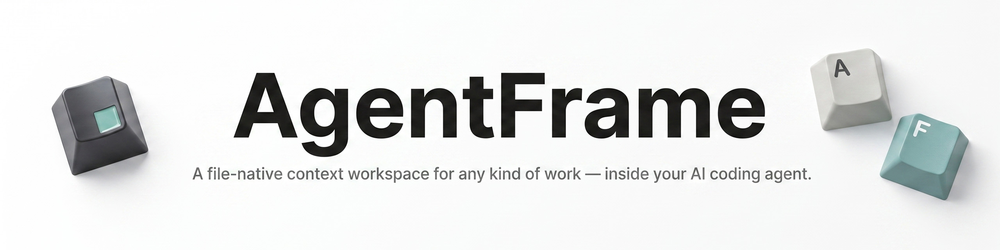

# AgentFrame



AgentFrame is a file-native workspace for one person's projects and life. You run it from Claude Code. Projects, deliverables, decisions, and context are plain Markdown files, so a fresh chat can read the workspace and pick up where the last one stopped.

It runs on Claude Code only. I built it for my own work and use it every day. It is free to fork, so take what is useful.

<p align="center">
  <a href="LICENSE"></a>
  
  
</p>

## Contents

- [What it is](#what-it-is)
- [The parts](#the-parts)
- [Quick start](#quick-start)
- [Repository map](#repository-map)
- [Privacy boundary](#privacy-boundary)
- [Design constraints](#design-constraints)
- [In progress](#in-progress)
- [Credits](#credits)
- [Licence](#licence)
- [Contact](#contact)

## What it is

Three ideas hold it together.

- **Files are the memory.** Each project keeps its state in `project.md` frontmatter, its raw inputs in `sources/`, what the agent has learned in `knowledge/`, and its deliverables as numbered versions. Nothing important lives only in a chat.
- **One main chat, one router per role.** `AGENTS.md` is the main chat's instruction: it runs the day from `workspace/life/` and dispatches to subagents, registered side chats, and background workers. Each chat gets its role from the sessions registry at session start and loads one router: `AGENTS.operator.md` for project work, `AGENTS.builder.md` for changes to the system, `AGENTS.worker.md` for unattended runs. The router points at the one file that owns the next step.
- **Buttons do the bookkeeping.** `af`, one Rust binary built from `system/af/`, makes the state changes the model should not do by hand and runs every Claude Code hook. The model does the research, the drafting, and the judgment.

<p align="center">
  
</p>

## The parts

### Projects and versioned deliverables

- `af new-project` scaffolds a project. Every project has the same shape: a plan, a tracker in the frontmatter, and deliverables.
- A deliverable is a folder of numbered files: `brief-v1.md`, `brief-v2.md`, and so on. The highest number is the head. Earlier versions never change.
- `af draft`, `af version`, `af ready`, and `af publish` move a deliverable through its life. They check the state, refuse bad shapes, and print a checklist for the judgment work.
- `af doctor` reports drift: dead links, files over their size cap, a tracker that disagrees with the files on disk. It reports and never fixes on its own.
- Templates live in `library/deliverables/` and inside each pack. Adding a type means adding a folder and a `template.md` written to the shape in `library/deliverables/_meta/`.

### Search

- `af search "what you half remember"` searches your projects, your context, your assets, and your plans.
- It fuses trigram keyword search with a local embedding model run through Ollama. Without Ollama it uses keywords alone and says so.
- The index is a gitignored SQLite file and only a cache. Delete it and `af index update --rebuild` builds it again.
- A golden set of your own questions gates every ranking change (`af index eval`).

<p align="center">
  
</p>

### The voice system

- It is built from pieces you have published, split into a formal and an informal register, plus contrastive pairs: a generic line next to your own rewrite.
- `af voice bundle` writes the files a draft needs into one file the agent reads once.
- Every draft runs four passes: content, style against your corpus, a clean pass against your anti-patterns, and a register test.
- `af voice lint` checks the rules a regex can check. The voice guard refuses `af ready` on a draft with hard findings.
- When you edit a draft and it ships, the `voice-harvest` skill proposes new pairs from your edits. Nothing changes until you approve it.
- The public shape lives in `library/schema/operator/voice/`. Your filled-in voice stays private.

### Domain packs

Three packs sit on top of a neutral default. A project's `domain` picks one.

| Pack | Used for |
|---|---|
| `project-mgmt` | The default. No extra fields and no fixed phases. Research, planning, writing, analysis. |
| `marketing` | Campaigns and posts: research, copy, visuals, decks, Substack, performance capture. |
| `careers` | Job applications on a pipeline board (`af pipe`): JD mapping, tailored resumes, ATS-safe exports, interview rounds. |
| `creator` | A short-form video channel on a calendar (`af studio`): recordings in, edits and posts out. |

### Owned skills

AgentFrame's own skills live in `.claude/skills/`, where Claude Code finds them. The catalog is [`.claude/skills/README.md`](.claude/skills/README.md).

| Skill | What it does | Who starts it |
|---|---|---|
| `agent-reach` | Reads sources the default tools cannot reach: Reddit, LinkedIn, X, YouTube transcripts, RSS | The model or you |
| `deep-research` | Multi-section research with source comparison and citations | The model or you |
| `deliverable-harvest` | Turns your edits on finished work into proposed template changes | You, or a process file |
| `voice-harvest` | Turns your edits on finished work into proposed voice pairs and corpus pieces | You, or a process file |
| `doc-export` | Exports a resume or cover letter as ATS-safe PDF and DOCX | You, or the careers pack |
| `job-scout` | Sweeps public job boards against your search profile | You |
| `d2-diagrams` | Renders auto-laid-out graphs with the D2 CLI | You, or a process file |
| `extract-design` | Pulls colours, type, and tokens from a live website | You, or a template |
| `gym` | Coaches a workout session from your private fitness log | You |

Skills marked "You" are hidden from the model's skill list, so their descriptions do not load into every chat. You run them as `/name`.

### Vendored runtimes

Third-party tools live in `system/vendor/`, each with a `VENDOR.md` that pins the upstream commit and lists the refresh steps. The catalog is [`system/vendor/README.md`](system/vendor/README.md).

| Runtime | What it does |
|---|---|
| `ppt-master` | Turns source material into designed SVG pages and editable PowerPoint decks |
| `pptx` | Inspects and edits PowerPoint files |
| `docx` | Creates and edits Word documents |
| `hyperframes` | Composes and renders video from HTML |
| `diagram-design` | Draws editorial diagrams as HTML and SVG; `system/tools/diagram_flatten.py` turns them into native PowerPoint shapes |

### Sessions and open loops

- `af session register <name>` puts a chat in `system/sessions/registry.md` with its role, brief, and handoff. Names follow `main`, `life/<topic>`, `project/<slug>`, `system/<topic>`, `worker/<slug>`.
- `af open add` raises a loop in `workspace/life/open.md` with an optional nudge date; due loops print at every main session start.
- `af brief` is the catch-up after days away: due loops, chats waiting, backlog, boards. It costs no tokens.
- Nine subagent roles in `.claude/agents/` (reader, researcher, filer, writer, reviewer, auditor, briefer, consolidator, builder) carry a pinned model and a narrow tool set.

### Hooks

`.claude/settings.json` runs `af hook <event>` for every hook, one process start of a few milliseconds each.

| Event | What `af hook` does |
|---|---|
| `session-start` | Prints the chat's role, brief, last handoff, and for main the whole of `life.md` and the due loops; renames the tab to the registered name; refreshes a stale search index in the background |
| `pre-tool-use` | Blocks edits to old versions, published heads, and hand-made version files; blocks `af ready` on hard voice findings; keeps deck projects out of the vendor folder; refuses a Substack push until its row is ready |
| `post-tool-use` | Prints the voice lint after `af version` and reminds the agent to promote a deck export |
| `stop` | Asks a registered side chat or worker for its handoff before it stops, once |
| `session-end`, `notification` | Stamp the registry row ended or last seen |

A `permissions.deny` rule for `git push` sits beside the hooks: the push is always yours.

## Quick start

1. Clone the repository:

   ```bash
   git clone https://github.com/situhacks/agentframe.git
   cd agentframe
   ```

2. Install Rust with [rustup](https://rustup.rs), then build and install the buttons, which puts `af` on your PATH:

   ```bash
   cargo install --path system/af
   ```

3. Open the folder in Claude Code. It reads `AGENTS.md` natively, and the session-start hook tells each chat its role.
4. Optional: copy `.env.example` to `.env` and set `GEMINI_API_KEY` for image generation. Everything else runs without keys.
5. Optional: install [Ollama](https://ollama.com) and run `ollama pull qwen3-embedding:0.6b` for semantic search.
6. Ask for a new project. Under the hood the agent runs:

   ```bash
   af new-project my-project
   ```

   It then proposes a plan sized to the goal, and you narrow it.

You need Claude Code and the Rust toolchain. Python 3 stays only for the media and Office tools under `system/tools/` and the vendored runtimes; some production routes also need Node, Microsoft Office on Windows, or Ollama. The tests run with `cargo test` in `system/af/` and `python -m pytest system/tests -q -p no:cacheprovider` for the tools.

## Repository map

```text
agentframe/
├── AGENTS.md                 # the main chat: run the day, dispatch, route by role
├── AGENTS.operator.md        # project execution
├── AGENTS.builder.md         # system construction and build hygiene
├── AGENTS.worker.md          # the overlay for unattended background runs
├── .claude/
│   ├── settings.json         # hook wiring and the push deny
│   ├── agents/               # subagent roles
│   └── skills/               # AgentFrame-owned skills
├── library/
│   ├── deliverables/         # shared templates and the deliverable shape
│   ├── domains/              # project-mgmt, marketing, careers, creator
│   ├── process/              # on-demand procedures, cataloged in README.md
│   ├── schema/               # public shapes of the private context files
│   └── assets/               # design languages, logos, media shelf (instances gitignored)
├── system/
│   ├── af/                   # the af crate: buttons, hooks, search, voice bundle and lint
│   ├── tools/                # media, render, diagram, and export helpers (Python, PowerShell)
│   ├── vendor/               # vendored runtimes
│   ├── docs/                 # PPT Master's upstream docs
│   └── tests/                # tests for the tools
└── workspace/                # your life layer, projects, pipeline, and studio (gitignored)
```

## Privacy boundary

The repository is public. The shapes travel; your content never does. These paths are gitignored:

- `workspace/life/`: your positioning, profile, voice, career bank, people, and channels, plus life knowledge, plans, and open loops. The public shapes for the context files live in `library/schema/`.
- `workspace/projects/`, `workspace/pipeline/`, `workspace/studio/`: your projects and their deliverables.
- `system/backlog.md`: the friction rows you and the agent append.
- The instances under `library/assets/design-languages/`, `logos/`, `media/`, and `audio/`: client brands and your own recordings.
- The search database, the golden set, and the voice bundle under `system/index/`; the chat registry, briefs, and handoffs in `system/sessions/`; the run log in `system/logs/`; model weights in `system/models/`; `.env`.
- Everything in `.claude/` except `settings.json`, `agents/`, and `skills/`: local plans, settings, and worktrees.

## Design constraints

- **Files are memory.** Markdown and frontmatter are the source of truth for project state.
- **Buttons own mechanics.** `af` makes state changes. It knows the schema, not the content, and it never makes a creative call.
- **Load lazily.** The root picks one router, the router points at one owner, and skills load only when the work calls for them.
- **One use for SQLite.** The search index is a derived cache. It is rebuildable and never the truth.
- **Mechanisms guard what must not be skipped.** A step that must always happen gets a hook, a doctor check, or a test. Prose is for judgment.

## In progress

Still ahead: the life systems (groceries and flyer deals first, then calendar and money), each with its own skill under `workspace/life/systems/`, and the self-repair loop, where main hands backlog rows to a builder worker and shows you its report.

## Credits

AgentFrame vendors or adapts these projects. Each keeps its licence and upstream record in its folder.

- [PPT Master](https://github.com/hugohe3/ppt-master)
- [HyperFrames](https://github.com/heygen-com/hyperframes)
- [Diagram Design](https://github.com/cathrynlavery/diagram-design)
- [Anthropic skills](https://github.com/anthropics/skills) (`docx`, `pptx`)
- [D2](https://github.com/terrastruct/d2)
- [design-extract](https://github.com/Manavarya09/design-extract) (`designlang`)
- [Agent Reach](https://github.com/Panniantong/Agent-Reach)
- [LunonAI deep research](https://github.com/LunonAI/lunon-deep-research), [deer-flow](https://github.com/bytedance/deer-flow), and [open_deep_research](https://github.com/langchain-ai/open_deep_research), which inform `deep-research`

The marketing-only predecessor is [agentframe-marketing](https://github.com/situhacks/agentframe-marketing).

## Licence

MIT. See [`LICENSE`](LICENSE).

## Contact

Built by Brandon Situ.

- [LinkedIn](https://www.linkedin.com/in/brandonsitu/)
- Email: brandonzsitu@gmail.com
