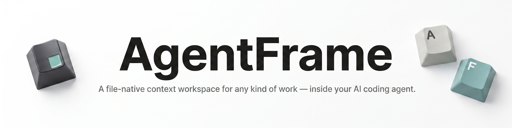

# AgentFrame



AgentFrame is a file-native workspace for one person's projects and life. You run it from Claude Code. Projects, deliverables, decisions, and context are plain Markdown files, so a fresh chat can read the workspace and pick up where the last one stopped.

It runs on Claude Code only. I built it for my own work and use it every day. It is free to fork, so take what is useful.

<p align="center">
  <a href="LICENSE"></a>
  
  
</p>

## Contents

- [What it is](#what-it-is)
- [The parts](#the-parts)
- [Quick start](#quick-start)
- [Repository map](#repository-map)
- [Privacy boundary](#privacy-boundary)
- [Design constraints](#design-constraints)
- [In progress](#in-progress)
- [Credits](#credits)
- [Licence](#licence)
- [Contact](#contact)

## What it is

Three ideas hold it together.

- **Files are the memory.** Each project keeps its state in `project.md` frontmatter, its raw inputs in `sources/`, what the agent has learned in `knowledge/`, and its deliverables as numbered versions. Nothing important lives only in a chat.
- **One main chat, one router per role.** `AGENTS.md` is the main chat's instruction: it runs the day from `workspace/life/` and dispatches to subagents, registered side chats, and background workers. Any chat can do anything; each does its job and routes the rest back to main. Each chat gets its role from the sessions registry at session start and loads one router: `AGENTS.operator.md` for project work, `AGENTS.builder.md` for changes to the system, `AGENTS.worker.md` for unattended runs. The router points at the one file that owns the next step.
- **Buttons do the bookkeeping.** `af`, one Rust binary built from `system/af/`, makes the state changes the model should not do by hand and runs every Claude Code hook. The model does the research, the drafting, and the judgment.

<p align="center">
  
</p>

## The parts

### Projects and versioned deliverables

- `af new-project` scaffolds a project. Every project has the same shape: a plan, a tracker in the frontmatter, and deliverables.
- A deliverable is a folder of numbered files: `brief-v1.md`, `brief-v2.md`, and so on. The highest number is the head. Earlier versions never change.
- `af draft`, `af version`, `af ready`, and `af publish` move a deliverable through its life. They check the state, refuse bad shapes, and print a checklist for the judgment work.
- `af doctor` reports drift: dead links, files over their size cap, a tracker that disagrees with the files on disk. It reports and never fixes on its own.
- Templates live in `library/deliverables/` and inside each pack. Adding a type means adding a folder and a `template.md` written to the shape in `library/deliverables/_meta/`.

### Search

- `af search "what you half remember"` searches your projects, your context, your assets, and your plans.
- It fuses trigram keyword search with a local embedding model run through Ollama. Without Ollama it uses keywords alone and says so.
- The index is a gitignored SQLite file and only a cache. Delete it and `af index update --rebuild` builds it again.
- A golden set of your own questions gates every ranking change (`af index eval`).

<p align="center">
  
</p>

### The voice system

- It is built from pieces you have published, split into registers (one file each, for example informal and chat), plus contrastive pairs: a generic line next to your own rewrite.
- `af voice bundle` writes the files a draft needs into one file the agent reads once.
- Every draft runs four passes: content, style against your corpus, a clean pass against your anti-patterns, and a register test.
- `af voice lint` checks the rules a regex can check. The voice guard refuses `af ready` on a draft with hard findings.
- When you edit a draft and it ships, the `voice-harvest` skill proposes new pairs from your edits. Nothing changes until you approve it.
- The public shape lives in `library/schema/operator/voice/`. Your filled-in voice stays private.

### Domain packs

Three packs sit on top of a neutral default. A project's `domain` picks one.

| Pack | Used for |
|---|---|
| `project-mgmt` | The default. No extra fields and no fixed phases. Research, planning, writing, analysis. |
| `marketing` | Campaigns and posts: research, copy, visuals, decks, Substack, performance capture. |
| `careers` | Job applications on a pipeline board (`af pipe`): JD mapping, tailored resumes, ATS-safe exports, interview rounds. |
| `creator` | A short-form video channel on a calendar (`af studio`): recordings in, edits and posts out. |

### Owned skills

AgentFrame's own skills live in `.claude/skills/`, where Claude Code finds them. The catalog, with what each skill owns, when to load it and who starts it, is [`.claude/skills/README.md`](.claude/skills/README.md); a skill it marks operator-only is hidden from the model's skill list and runs as `/name`.

### Vendored runtimes

Third-party tools live in `system/vendor/`, each with a `VENDOR.md` that pins the upstream commit and lists the refresh steps. The catalog is [`system/vendor/README.md`](system/vendor/README.md).

| Runtime | What it does |
|---|---|
| `ppt-master` | Turns source material into designed SVG pages and editable PowerPoint decks |
| `pptx` | Inspects and edits PowerPoint files |
| `docx` | Creates and edits Word documents |
| `hyperframes` | Composes and renders video from HTML |
| `diagram-design` | Draws editorial diagrams as HTML and SVG; `system/tools/diagram_flatten.py` turns them into native PowerPoint shapes |

### Sessions and open loops

- `af session register <name>` puts a chat in `system/sessions/registry.md` with its role, brief, and handoff. Names follow `af-main` (the main chat), `life/<topic>`, `project/<slug>`, `system/<topic>`, `worker/<slug>`.
- `af open add` raises a loop in `workspace/life/open.md` with an optional nudge date, and `--every monthly`, `weekly`, or `Nd` makes it recur; due loops print at every registered interactive chat's start. `af open close` moves a loop to the month log with its outcome (a recurring loop is logged and re-dated one period on; `--final` ends it), and `af open redate` changes its nudge date in place. Open loops are the only reminder mechanism.
- `af needs add|close|move|list|render` keeps the list of what main needs him to decide: each item is a marked loop in `open.md` carrying its recommendation, options and reason (`af needs set` changes them), and `workspace/life/needs.md` is the generated view: Now, Do (plain due loops that are his to act on), and Later. Any `af` read or write of the loops moves a dated item to Now once its date passes, and it reaches `af open due` and the phone push.
- `af brief` is the catch-up after days away: due loops, needs, chats waiting, backlog, boards. It costs no tokens.
- `af session transcript <name> --around <time>` prints the conversation around a moment of a registered chat (text and one line per tool call), so a fix reads what happened where a backlog row says it surfaced.
- `af session reach <name>` says whether a message reaches a chat and starts a turn, and what to do when it will not; `--confirm "<phrase>"` checks one arrived. `SendMessage` answering success proves neither.
- `af session compact <name>` compacts a chat from outside it when it has no live process, and through the VS Code panel when it is running; `--when-idle` returns at once and compacts the chat once it finishes its turn, `--then-file` sends a file as its next message, `--dry-run` shows the plan first, and `--cancel` stops a queued `--when-idle` compaction while it only waits. A chat already compacted since its last reply is reported as already compact. `af session rename`, `start` (with `--model`, and `--group` for an existing group, which places the new chat with `group add` once it is started), `archive`, `group` and `panel` use the same driver, `system/tools/claude_panel.ps1`, which sends no key or mouse input except for the group verbs (opening a chat's tab or pressing a panel button does make VS Code take the keyboard focus for the few seconds of the run, and at the end the driver hands the foreground back to the window that had it when he has not touched the computer): it works through UI Automation patterns and a small VS Code extension, `system/vscode-bridge/`, that closes and opens chat tabs, and it acts only when the operator and the chat are idle and the input reads back as exactly the text. A minimized VS Code is restored behind his window and minimized again (still maximized if it was) unless he has it in front, or he is at the computer and can see it. `af session archive` moves the pointer (onto the chat's row and back, nothing is clicked); it never archives the chat he has in front, and it waits while a full-screen window covers the row. `af session group list|create|rename|delete|add|remove` manages the panel's session groups and puts a chat in one or takes it out: the panel's menus open only on a real right-click and a name is typed, so these verbs take his pointer and keyboard focus for a few seconds while he is idle, then put the pointer, an open menu and the foreground back; `--dry-run` shows the driver call and what would show on his screen.
- `af place add|visit|verdict|list` and `af person add` own the mechanics of `workspace/life/places/` and `people/` pages.
- `af save [--dry-run]` commits `workspace/`, the private layer's own local git repo. It never fetches, pulls, merges or pushes.
- Ten subagent roles in `.claude/agents/` (reader, researcher, filer, writer, reviewer, auditor, briefer, consolidator, builder, desk) carry a pinned model and a narrow tool set. `desk` runs the Claude panel for another chat: it starts a side chat from its brief, registers it, names it, puts it in a group, and compacts or archives chats.

### Hooks

`.claude/settings.json` runs `af hook <event>` for every hook, one process start of a few milliseconds each.

| Event | What `af hook` does |
|---|---|
| `session-start` | Prints the chat's role, brief, last handoff, and for main the whole of `life.md` and the due loops; has an unregistered chat ask whether it is main, a side chat, or a one-off; renames the tab to the registered name; refreshes a stale search index in the background |
| `pre-tool-use` | Turns any shell command that runs `git push` into a permission prompt; blocks edits to old versions, published heads, and hand-made version files; refuses a hand-written new file under `workspace/life/sources/` (`af source add` files it); blocks `af ready` on hard voice findings; keeps deck projects out of the vendor folder; refuses a Substack push until its row is ready |
| `post-tool-use` | Prints the voice lint after `af version` and reminds the agent to promote a deck export; after any tool, nudges every chat to bring its handoff up to date at its soft limit and to compact at its hard limit (main 350k and 450k, side 300k and 400k, build 400k and 600k; a brief's `soft:` and `hard:` lines override them) |
| `pre-compact`, `post-compact` | Print the chat's standing summary instructions (name, role, brief, handoff and plan paths, current step, decisions, open questions, files touched) so every compaction keeps them; after it, the context nudge re-arms |
| `stop` | Asks a registered side chat or worker for its handoff before it stops, once, and says whether it is missing, lacks `written:`, or is stale; when the chat really stops, commits the private layer (`af save`) |
| `session-end`, `notification` | Stamp the registry row ended or last seen |

A push happens only on your explicit yes. A `permissions.ask` rule for `git push` prompts you for every push, in bypass-permissions mode too, and the pre-tool-use hook turns a push buried in a compound command into the same prompt. `AGENTS.md` carries the rule for the model.

### Schedules

One Windows Task Scheduler job, `AgentFrame consolidation`, runs every Sunday at 18:00 while you are logged on. It runs the `consolidator` role headless over `workspace/life/`: each knowledge page's current facts are rebuilt from its timeline, old timeline entries are archived, and loop closures are proposed but not made. It commits nothing. The report lands in `system/logs/consolidation-<date>.md`, and a loop nudges you on Monday to review it with `git -C workspace diff --stat`. Register it once from your own checkout with `powershell -NoProfile -ExecutionPolicy Bypass -File system/tools/register-weekly-consolidation.ps1`; it prints the next run time, and rerunning it replaces the job.

| Script | What it does |
|---|---|
| `system/tools/consolidate-weekly.ps1` | One consolidation run: the headless `claude -p` call, the log file, the Monday review loop |
| `system/tools/register-weekly-consolidation.ps1` | Creates or replaces the Sunday 18:00 task and prints its next run |
| `system/tools/push-due-loops.ps1` | One reminder push: `af open due --json` as headings and bullets, led by the loop sweep's overdue list, posted to Discord through `system/tools/notify.py`; loops that look sensitive show only as a count and amounts are masked (`off_discord.py`), and without the private terms file it sends only counts; `-DryRun` prints instead |
| `system/tools/watch-batch.ps1` | One batch run: sweeps expired `af watch` items, checks each due one, raises a loop and sends a phone message for each that is met, and on the first run from 09:55 runs the bills watch, loop watch, loop sweep, harness review and the push above (`-SweepLive` lets the sweep close loops on proof; `-DryRun` prints and writes nothing) |
| `system/tools/register-watch-batch.ps1` | Creates or replaces the `AgentFrame batch` task (10:00, 15:00, 19:00) and prints its next run |
| `system/tools/timers.ps1` | Shows, registers or removes every job above; `-Register` and `-Unregister` also remove the four tasks the batch replaced |
| `system/tools/backlog-pass.ps1` | One backlog pass: raises a loop naming the oldest rows `af backlog ready` lists, for main to dispatch to a reviewed builder. It starts no builder and runs no git. `-DryRun` prints the loop |
| `system/tools/register-backlog-pass.ps1` | Creates or replaces the Sunday 20:00 task `AgentFrame backlog pass` and prints its next run |

A second job, `AgentFrame batch`, runs `watch-batch.ps1` at 10:00, 15:00 and 19:00 while you are logged on, and at the next time available if the PC was off. Every run checks the [`af watch` queue](library/schema/watch.md) and posts only when something was met or failed. The first run from 09:55 each day also does the morning jobs once: the bills watch, the loop watch, the loop sweep, then the reminder push, which carries the day's watch lines first. A morning job that exits 3 finished partly (the loop watch, with some loops failed and others checked) and does not mark the task failed; its own report has the detail. The Discord credentials go in `system/tools/.env`, which git ignores; `notify.py` names the variables, and the batch run needs `REMINDERS_DISCORD_CHANNEL_ID` for its phone messages (without it the run still checks and raises loops). Register it with `system/tools/register-watch-batch.ps1`, or all the jobs with `system/tools/timers.ps1 -Register`, which also removes the four tasks the batch replaced.

`system/tools/discord_board.py` keeps Discord boards current by editing in place (a changed post or board also gets one "Updated" message so it shows as unread; `--no-bump` skips it), where `notify.py` only appends: `board <key> <file>` maintains a text channel's one pinned board, `post <key> <slug> <file> --title "<title>" [--tag <name>]` one forum post per item, and `--dry-run` prints without sending or writing. It reads the same `.env` and keeps its message ids in `workspace/life/systems/discord/state.json`.

## Quick start

1. Clone the repository:

   ```bash
   git clone https://github.com/situhacks/agentframe.git
   cd agentframe
   ```

2. Install Rust with [rustup](https://rustup.rs), then build and install the buttons, which puts `af` on your PATH:

   ```bash
   cargo install --path system/af
   ```

3. Open the folder in Claude Code. It reads `AGENTS.md` natively, and the session-start hook tells each chat its role.
4. Optional: copy `.env.example` to `.env` and set `GEMINI_API_KEY` for image generation. Everything else runs without keys.
5. Optional: install [Ollama](https://ollama.com) and run `ollama pull qwen3-embedding:0.6b` for semantic search.
6. Ask for a new project. Under the hood the agent runs:

   ```bash
   af new-project my-project
   ```

   It then proposes a plan sized to the goal, and you narrow it.

You need Claude Code and the Rust toolchain. Python 3 stays only for the media and Office tools under `system/tools/` and the vendored runtimes; some production routes also need Node, Microsoft Office on Windows, or Ollama. The tests run with `cargo test` in `system/af/` and `python -m pytest system/tests -q -p no:cacheprovider` for the tools.

## Repository map

```text
agentframe/
├── AGENTS.md                 # the main chat: run the day, dispatch, route by role
├── AGENTS.operator.md        # project execution
├── AGENTS.builder.md         # system construction and build hygiene
├── AGENTS.worker.md          # the overlay for unattended background runs
├── .claude/
│   ├── settings.json         # hook wiring, the push confirmation rule, worktree setting
│   ├── agents/               # subagent roles
│   └── skills/               # AgentFrame-owned skills
├── library/
│   ├── deliverables/         # shared templates and the deliverable shape
│   ├── domains/              # project-mgmt, marketing, careers, creator
│   ├── process/              # on-demand procedures, cataloged in README.md
│   ├── schema/               # public shapes of the private context files
│   └── assets/               # design languages, logos, media shelf (instances gitignored)
├── system/
│   ├── af/                   # the af crate: buttons, hooks, search, voice bundle and lint
│   ├── tools/                # media, render, diagram, export, and schedule helpers (Python, PowerShell)
│   ├── vendor/               # vendored runtimes
│   ├── docs/                 # PPT Master's upstream docs
│   └── tests/                # tests for the tools
└── workspace/                # your life layer, projects, pipeline, and studio (gitignored)
```

## Privacy boundary

The repository is public. The shapes travel; your content never does. These paths are gitignored:

- `workspace/life/`: your positioning, profile, voice, career bank, people, and channels, plus life knowledge, plans, and open loops. The public shapes for the context files live in `library/schema/`.
- `workspace/projects/`, `workspace/pipeline/`, `workspace/studio/`: your projects and their deliverables.
- `system/backlog.md`: the friction rows you and the agent append.
- The instances under `library/assets/design-languages/`, `logos/`, `media/`, and `audio/`: client brands and your own recordings.
- The search database, the golden set, and the voice bundle under `system/index/`; the chat registry, briefs, and handoffs in `system/sessions/`; the run log in `system/logs/`; model weights in `system/models/`; `.env`.
- Everything in `.claude/` except `settings.json`, `agents/`, and `skills/`: local plans, settings, and worktrees.

## Design constraints

- **Files are memory.** Markdown and frontmatter are the source of truth for project state.
- **Buttons own mechanics.** `af` makes state changes. It knows the schema, not the content, and it never makes a creative call.
- **Load lazily.** The root picks one router, the router points at one owner, and skills load only when the work calls for them.
- **One use for SQLite.** The search index is a derived cache. It is rebuildable and never the truth.
- **Mechanisms guard what must not be skipped.** A step that must always happen gets a hook, a doctor check, or a test. Prose is for judgment.

## In progress

Still ahead: the life systems (groceries and flyer deals first, then calendar and money), each with its own skill under `workspace/life/systems/`, and a cloud variant of `/upgrade` that runs the builder on the tracked repository and lands a branch for you to merge.

## Credits

AgentFrame vendors or adapts these projects. Each keeps its licence and upstream record in its folder.

- [PPT Master](https://github.com/hugohe3/ppt-master)
- [HyperFrames](https://github.com/heygen-com/hyperframes)
- [Diagram Design](https://github.com/cathrynlavery/diagram-design)
- [Anthropic skills](https://github.com/anthropics/skills) (`docx`, `pptx`)
- [D2](https://github.com/terrastruct/d2)
- [design-extract](https://github.com/Manavarya09/design-extract) (`designlang`)
- [Agent Reach](https://github.com/Panniantong/Agent-Reach)
- [LunonAI deep research](https://github.com/LunonAI/lunon-deep-research), [deer-flow](https://github.com/bytedance/deer-flow), [open_deep_research](https://github.com/langchain-ai/open_deep_research), and Anthropic's deep-research skill, which inform `deep-research`

The marketing-only predecessor is [agentframe-marketing](https://github.com/situhacks/agentframe-marketing).

## Licence

MIT. See [`LICENSE`](LICENSE).

## Contact

Built by Brandon Situ.

- [LinkedIn](https://www.linkedin.com/in/brandonsitu/)
- Email: brandonzsitu@gmail.com
