# AgentFrame


AgentFrame is a file-native context workspace for running any kind of work alongside Claude Code. The projects, context, deliverables, decisions, and feedback loops are all plain markdown files. Everything about your work stays organized, so a fresh agent can read the workspace and pick up where you left off without a lengthy re-explanation.

I built it for my professional and personal work over many weekends, with likely many more to come. It's free to fork, so take whatever is useful for your own setup.

<p align="center">
  <a href="LICENSE"></a>
  
  
</p>

## Table of contents

- [Why this exists](#why-this-exists)
- [Key features](#key-features)
- [Quick start](#quick-start)
- [What it can run](#what-it-can-run)
- [A real project, step by step](#a-real-project-step-by-step)
- [At a glance](#at-a-glance)
- [Architecture](#architecture)
- [Repository map](#repository-map)
- [Integrations](#integrations)
- [Design constraints](#design-constraints)
- [Contributing](#contributing)
- [References and lineage](#references-and-lineage)
- [License](#license)
- [Contact](#contact)

## Why this exists

The first version of AgentFrame was a marketing system. It came from trying to run campaigns in raw AI chat windows. Individual chats became huge token sinks with context rot, while starting a new chat meant briefing it again on the same task. I created AgentFrame to organize my context into structured files, so one prompt could become a repeatable process and one campaign could become an example for future ones.

Then I kept using the marketing system for work that had nothing to do with marketing. I ran PowerPoint redesigns through it, made Word document deliverables, and did small research jobs by asking my coding agent to treat them as "campaigns." That worked surprisingly well, which made the useful part of AgentFrame obvious: it was not just the marketing workflow but the context organization. It was the way the system kept project state, versioned the work, and carried the right information into the next step.

So I rebuilt AgentFrame around the smallest piece of work: projects. Marketing is still there, but now it is one domain pack beside project management and careers, while the core handles the things all of them share: context, state, deliverables, and the path between them. That rebuild also gave me the parts I care about most now, including long-horizon memory kept in plain files, a voice system trained on my actual edits, and deliverables that keep a version trail.

The original marketing-only system is frozen at [agentframe-marketing](https://github.com/situhacks/agentframe-marketing). This repository is its successor.

## Key features

AgentFrame keeps its context, working rules, and project state in plain files that Claude Code reads and writes.

### 1. Pick up a project without re-briefing

- **Reconstruct the project from disk.** After a memory compaction, a provider switch, or a month-long hiatus, a fresh agent reads the project files and continues from the same state. You do not need to write a catch-up paragraph or upload the brief again.

- **Keep sources and working knowledge separate.** Transcripts and briefs land in `sources/` and never get edited. The agent maintains what it has learned from them in `knowledge/`, and resolved detail moves to an archive folder when the live files get too long.

- **Load only what the task needs.** The stable root selects one task router; that router points to the project or system owner, and those files route to the process for the current step. Skills stay out of context until the work calls for them, so the workspace can get large without every chat carrying all of it.

### 2. Reuse instructions shaped by real work

- **Start from templates and processes that have already been used.** Every deliverable shape and workflow in the library has been refined through real work. The coding agent model and tools can change without affecting the underlying system knowledge.

- **Add specialised structure through domain packs.** Marketing, project management, and careers ship today. Adding another domain means adding its templates and descriptor rather than rewriting the core.

- **Teach the voice system from real edits.** It reads complete pieces you have published, keeps reusable voice registers separate from channel rules, and compares agent drafts against your rewrites. A formal or informal voice can travel across posts, emails, decks, and essays, with an explicit blend when one register needs a controlled borrow from the other.

<p align="center">
  
</p>

### 3. Keep state and automation deterministic

- **Run project state changes through commands.** Models are good at research, synthesis, and drafting; deterministic commands handle the exact bookkeeping. The `system/af.py` script manages creation, versioning, readiness, publishing, and doctor checks without using model tokens. If anything is out of order, it flags the problem for the agent to reason over.

- **Keep a version trail for every deliverable.** Replacement-shaped revisions become immutable snapshots, the tracker or artifact folder identifies the current numeric head, and readiness gates run before use or sharing. When the deliverable needs a real file (e.g., PPTX, DOCX), the export is tracked too.

- **Record what happened as part of the work.** Activity logs and version notes cover projects, and git history covers the system. `af doctor` reports drift without silently fixing it.

### 4. Learn deliberately from finished work

- **Harvest at publish time.** When a deliverable goes ready or publishes, and once more when a project closes, two harvest passes compare the agent's drafts with your hand edits and the published copy. They propose template and voice changes in one review, and nothing changes until you approve it.

- **Send friction to the backlog.** When a command refuses a legitimate shape or a rule misfires, the agent logs a row in the builder backlog instead of quietly working around it, so system fixes happen in a dedicated session.

### 5. Find anything you've ever written

- **Search every project at once.** `python system/af.py search "<whatever you half-remember>"` retrieves across projects, plans, templates, and system docs, phrased the way you'd ask rather than the filename you forgot. Ranking fuses exact-match trigram search with an embedding model run locally through Ollama, so exact identifiers and fuzzy meaning both land.

- **A cache, never a second truth.** The index is a gitignored SQLite database rebuilt with one command; your files stay the only source of truth. Search returns pointers, and the agent opens the cited files before relying on them. Without the optional embedding backend, search degrades to keyword-only and says so.

<p align="center">
  
</p>

## Quick start

1. Clone the repository:

   ```bash
   git clone https://github.com/situhacks/agentframe.git
   cd agentframe
   ```

2. Open the folder in Claude Code.

3. Copy `.env.example` to `.env` and set `GEMINI_API_KEY` if you want Gemini image generation. The workspace, CLI, and project system all run without API keys.

4. Tell the agent: **"Start a new project."** The stable root routes project work to the Operator instructions; under the hood the state transition is:

   ```bash
   python system/af.py new-project my-project --domain project-mgmt
   ```

   The agent proposes a plan scaled to your objective, and you narrow it. Knowledge files appear only when the work produces them.

### Modes

One stable `AGENTS.md` classifier routes each task to a lazy-loaded instruction file with a hard ownership boundary:

- **Operator** runs projects and career work under `workspace/` and reads the system on demand.
- **Builder** evolves the templates, packs, processes, personas, CLI, and runtime under `library/` and `system/`.

The root file is never rewritten to change modes. An agent reads only the task-local router it needs, then switches routers if the task's ownership changes.

## What it can run

Three domain packs and two work topologies ship today.

| Surface | What it is for | Default shape |
|---|---|---|
| **Open project** | The domain-neutral starting point for research, planning, building, writing, or analysis; use it for any objective the model and its tools can handle | `project-mgmt`; no fixed phase ladder, no mandatory knowledge files |
| **Marketing project** | Research, campaign architecture, copy, visuals, video, decks, publishing, and performance capture | `marketing`, with an optional campaign phase checklist |
| **Life project** | A private, ongoing project for evolving personal and career-life context, decisions, research, and work | Lazily scaffolded `project-mgmt`; no separate schema |
| **Career workspace** | Ongoing career context, internal progression, promotion evidence, and structured application cases | Career bank + calendar/pipeline + case folders |

The open project is the default because most work fits inside a project shape before it needs anything more specialised. A frontier model can reason about and tailor the project for just about anything, so you do not have to design a domain pack every time. Packs are for the jobs you repeat often enough to justify a stronger shape.

### Projects that work in a code repository

When a project works in a code repository, `project.md` points at it with one `repo:` key. The code and its history stay in that repository, while AgentFrame keeps the plan, sources, decisions, and deliverables.

## A real project, step by step

The content changes between packs, but the project path stays familiar: bring the context in, version the work as it changes, deliver it through a gate, and keep what the next project should learn.

### A project-management project

The project-management pack is the default shape: sources come in, the agent keeps working knowledge current in `knowledge/`, and deliverables ship through the same versioned path.

<table>
<tr>
<td width="50%" valign="top">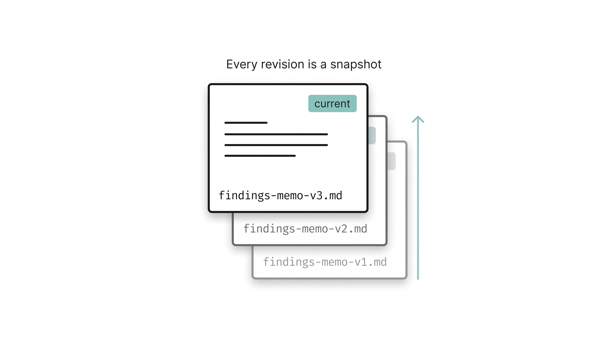<br/><sub><b>1 · Draft deliverables.</b> Findings, memos, and decks are drafted in your voice from the deliverable library, and every replacement-shaped revision becomes an immutable <code>-v{N}</code> snapshot.</sub></td>
<td width="50%" valign="top">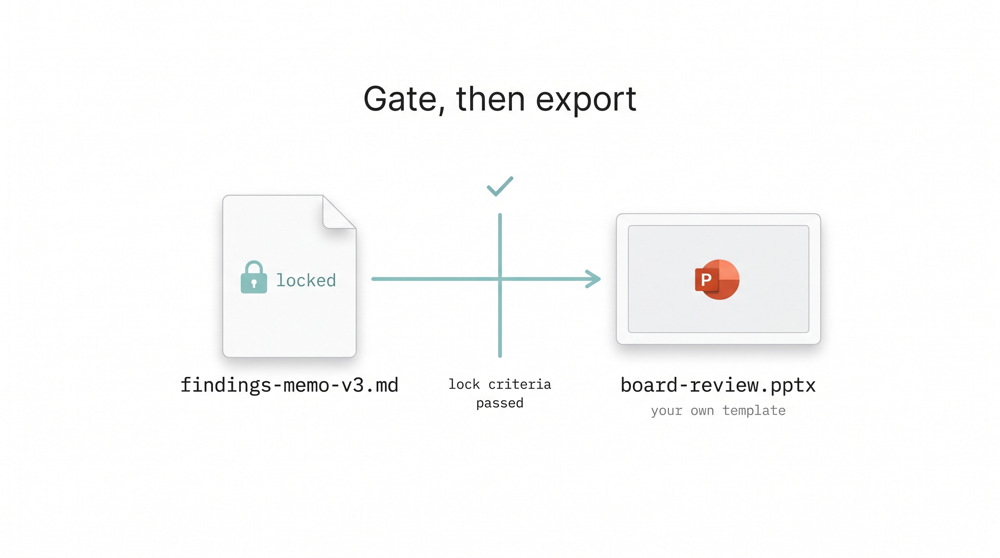<br/><sub><b>2 · Deliver.</b> Deliverables pass readiness criteria before delivery is recorded, including deck exports in your own PowerPoint template when the destination needs a file.</sub></td>
</tr>
<tr>
<td width="50%" valign="top">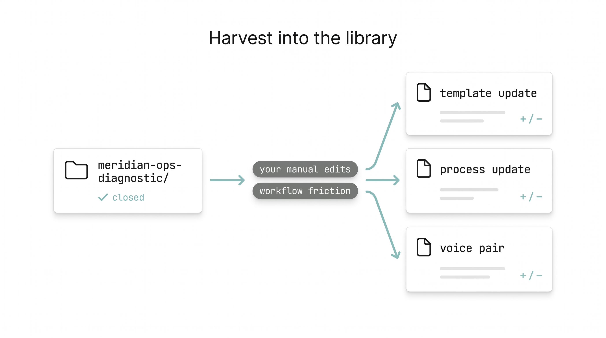<br/><sub><b>3 · Learn.</b> Harvests at ready, publish, and closeout turn your manual edits into proposed template and voice improvements.</sub></td>
<td width="50%" valign="top"></td>
</tr>
</table>

### A marketing campaign

The marketing pack has the most visual production because it is where this workspace started.

<table>
<tr>
<td width="50%" valign="top">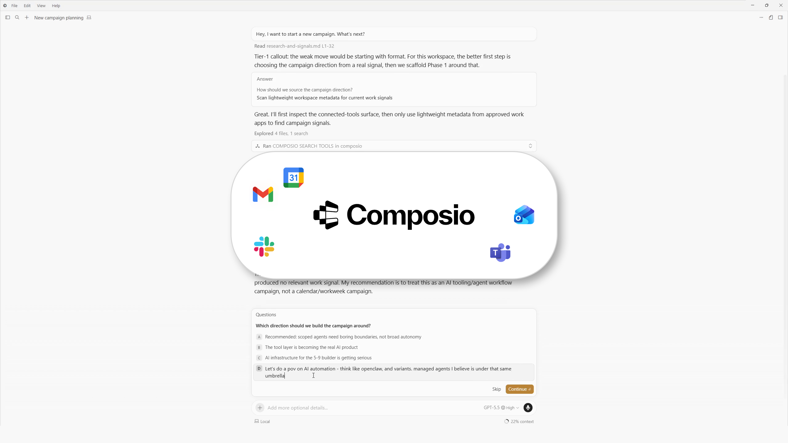<br/><sub><b>1 · Kickoff.</b> Scaffold the project, load operator context, gather live signals, and choose the research depth.</sub></td>
<td width="50%" valign="top">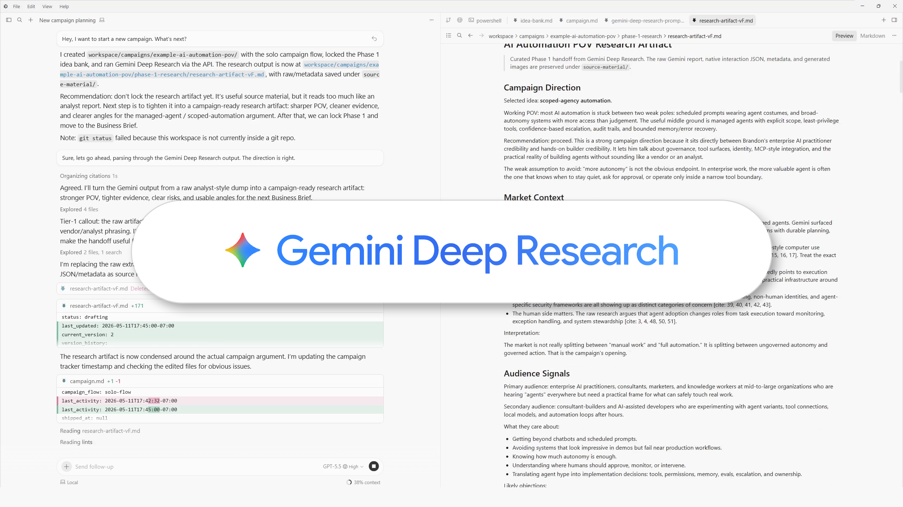<br/><sub><b>2 · Research.</b> Use the native multi-role research skill or a Gemini web handoff and keep the cited artifact in the project.</sub></td>
</tr>
<tr>
<td width="50%" valign="top">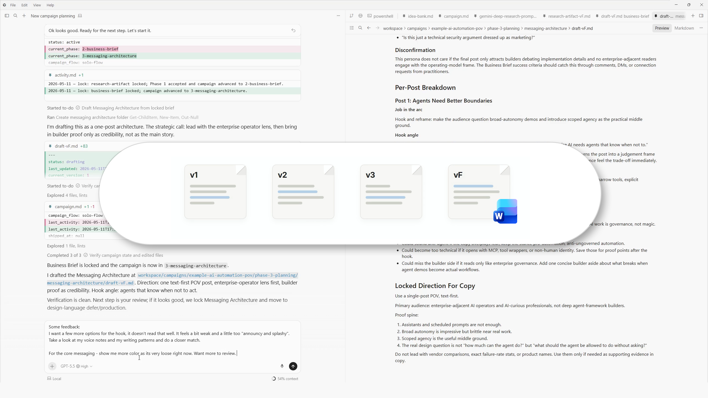<br/><sub><b>3 · Draft.</b> Build from templates, the gold voice corpus, register guidance, and project evidence. Every replacement-shaped revision becomes a snapshot.</sub></td>
<td width="50%" valign="top">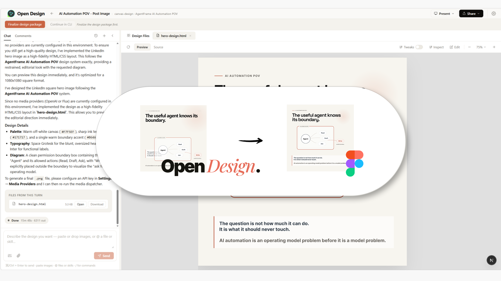<br/><sub><b>4 · Produce.</b> Route images, diagrams, decks, carousels, or video through the appropriate production process.</sub></td>
</tr>
<tr>
<td width="50%" valign="top">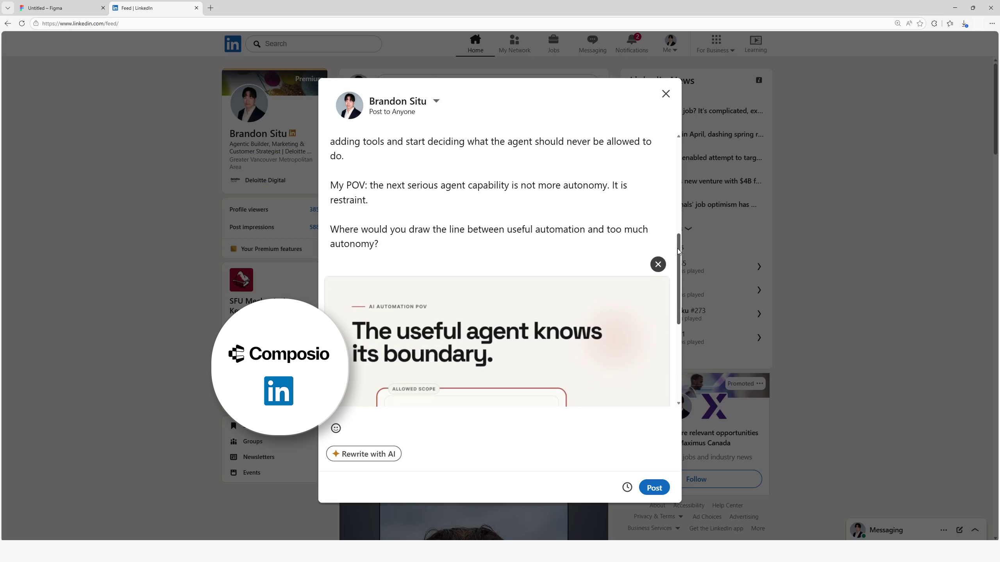<br/><sub><b>5 · Deliver.</b> Deterministic gates verify ready copy and landed exports before publishing is recorded.</sub></td>
<td width="50%" valign="top">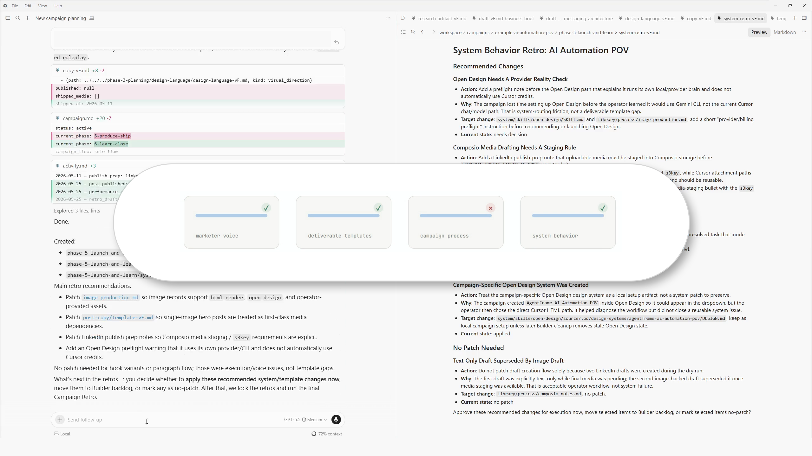<br/><sub><b>6 · Learn.</b> Harvest real edits into proposed voice and template improvements, one review per pass.</sub></td>
</tr>
</table>

### A career workspace

The careers pack treats your own career as a long project. It is built first for the internal case: turning the work you are already doing into promotion evidence, because this is a work workspace before it is a job-search tool. The same system also handles external searching and login-free job scouting when you need it.

<table>
<tr>
<td width="50%" valign="top">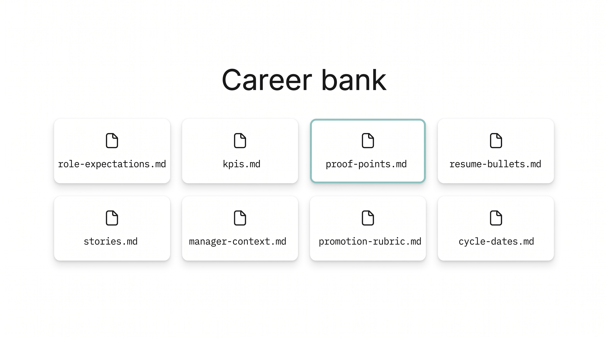<br/><sub><b>1 · Build the career bank.</b> Role expectations, KPIs, proof points, resume bullets, stories, manager context, promotion rubrics, and cycle dates live as durable files.</sub></td>
<td width="50%" valign="top">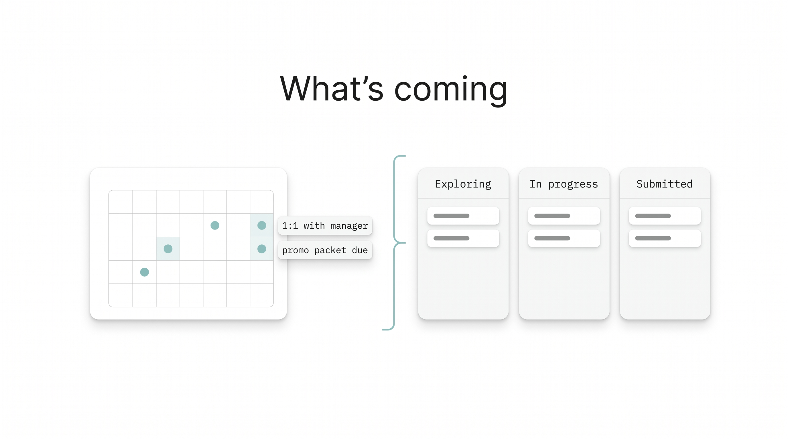<br/><sub><b>2 · See what's coming.</b> Cycle dates and the pipeline board keep upcoming conversations, submission dates, and follow-ups in view.</sub></td>
</tr>
<tr>
<td width="50%" valign="top">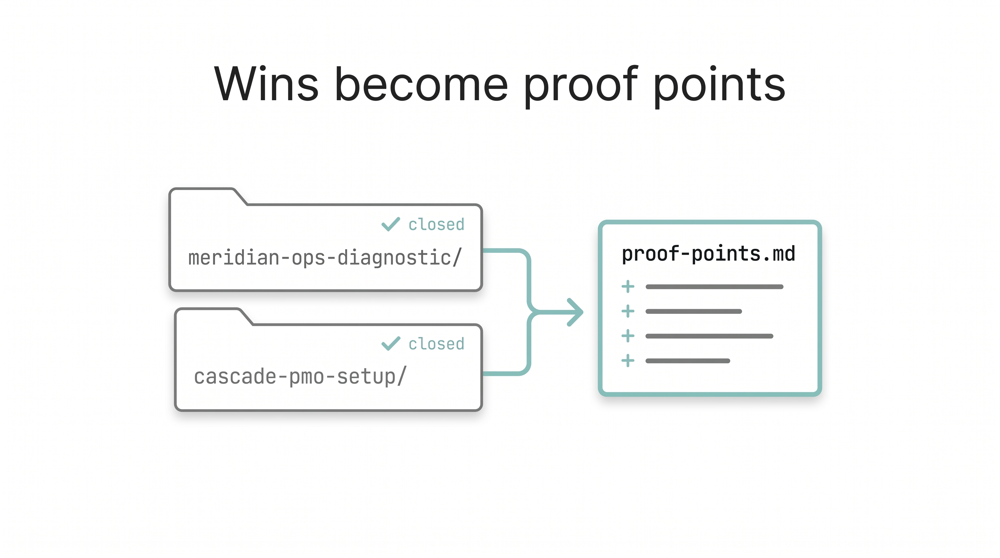<br/><sub><b>3 · Gather evidence.</b> Completed projects already contain your wins; harvest passes turn them into proof points and a running impact record instead of a panic the week before review season.</sub></td>
<td width="50%" valign="top">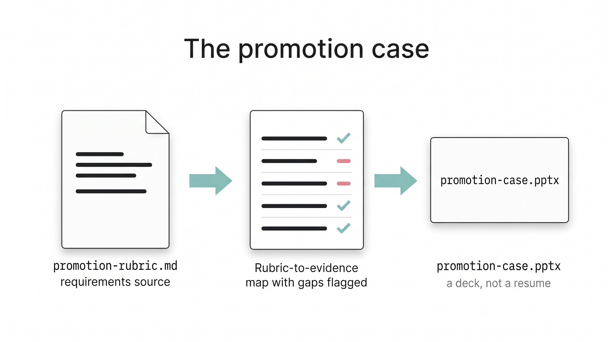<br/><sub><b>4 · Run a case.</b> An internal promotion case works like any evidence-backed application: the rubric becomes the requirements source, gaps become a plan, and the final material can be a deck rather than a resume.</sub></td>
</tr>
<tr>
<td width="50%" valign="top">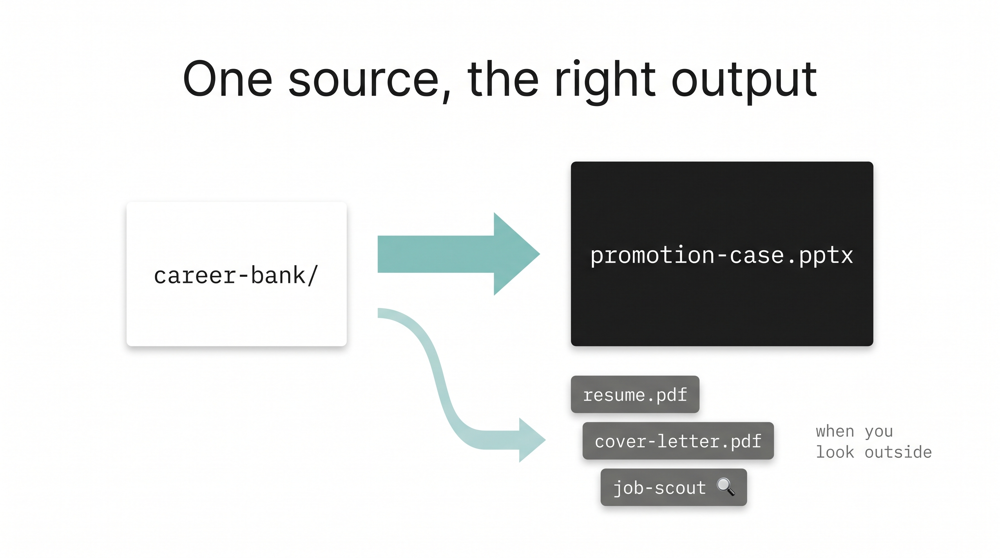<br/><sub><b>5 · Produce materials.</b> A promotion case exports as a deck; when you do look outside, the same system can produce ATS-aware resume and cover-letter files and scouts public job feeds.</sub></td>
<td width="50%" valign="top">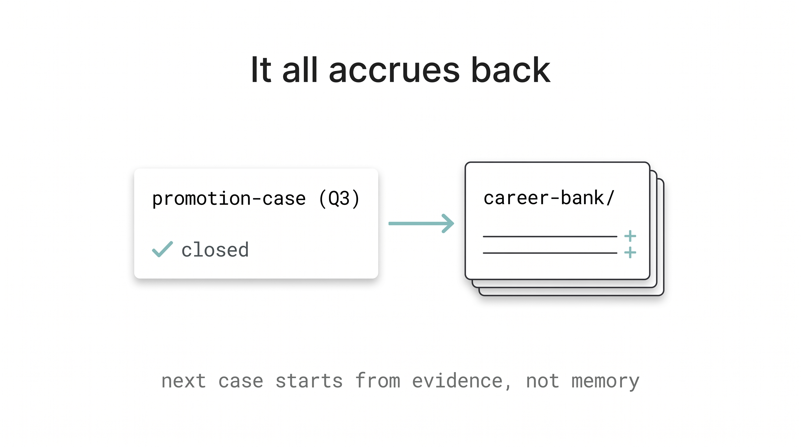<br/><sub><b>6 · Keep the record.</b> Everything accrues back into the bank, so the next case starts from evidence instead of memory.</sub></td>
</tr>
</table>

## At a glance

This is the full capability catalog. AgentFrame does not rebuild every production tool from scratch: deck generation, advanced visuals, video composition, prose cleanup, and deep research come from community projects that already do those jobs well. AgentFrame adds its own process and adaptations, while each vendored skill keeps its upstream source and refresh path nearby. The process files and templates are AgentFrame's own and have been refined through real work.

### Skills

| Skill | What it does | Provenance |
|---|---|---|
| `agent-reach` | Read-only reach for sources the default toolchain can't fetch: Reddit, LinkedIn, X, YouTube transcripts, RSS, semantic search | Vendored |
| `agentframe-structure` | Safely changes deliverable types, processes, and ownership boundaries | Internal |
| `d2-diagrams` | Auto-laid-out graphs for regenerated topologies | Internal (pinned D2 binary vendored) |
| `diagram-design` | 39 editorial diagram grammars as self-contained HTML/SVG; flattens to native PowerPoint shapes | Vendored |
| `deep-research` | Architect → specialist → synthesis research on the agent's own tools | Internal (prompts adapted from upstream) |
| `deliverable-harvest` | Mines version trails and published copy for template improvements, applied after one review | Internal |
| `deliverable-scaffolding` | Creates deliverable instances with the correct shape and frontmatter | Internal |
| `doc-export` | Produces ATS-safe resume and cover-letter files keyed to the destination system | Adapted |
| `docx` | Creates, inspects, and edits Word documents | Vendored |
| `extract-design` | Measures a website's design language via the `designlang` CLI | Vendored |
| `humanizer` | Detects and removes common AI-writing patterns | Vendored |
| `hyperframes` | HTML-to-video composition: Studio, CLI, engine, and routed video skills | Vendored |
| `job-scout` | Sweeps public ATS feeds against the career search profile, login-free | Adapted |
| `ppt-master` | Converts sources into designed SVG pages and native-editable PowerPoint decks | Vendored |
| `pptx` | Inspects, validates, and performs native PowerPoint edits | Vendored |
| `voice-harvest` | Turns edit deltas and published finals into contrastive pairs, voice-file patches, and corpus examples | Internal |

Vendored skills keep a skill-local `VENDOR.md` with the upstream source and refresh procedure, so pulling the latest community version is a documented step. The live index is [`system/skills/README.md`](system/skills/README.md).

### Processes

All AgentFrame-owned. Each loads on demand when the work reaches it.

| Process | What it gives the agent |
|---|---|
| `career-harvest` | Promotion of real project wins into proof points, stories, and resume-bank bullets |
| `deck-production` | Central deck routing with PPT Master as the default for new PowerPoint work |
| `deliverable-versioning` | Head pointers, immutable snapshots, and revision judgment |
| `diagram-production` | Diagram route selection, the native-shape deck handoff, and design-language brand projection |
| `humanizer-integration` | A calibrated humanization pass where a template calls for it |
| `image-production` | Path selection across generated imagery, diagrams, and HTML visuals |
| `knowledge-base` | Source ingestion, living knowledge files, and archives |
| `native-office-render` | Renders PPTX/DOCX to pixels or PDF through installed Microsoft Office — the only sanctioned renderer |
| `ready-event` | Readiness mechanics, the post-ready judgment checklist, and the voice-harvest gate |
| `operator-context-setup` | First-run generation of positioning, profile, career, and voice surfaces |
| `performance-capture` | Connector-first post metrics capture and the raw performance CSV shape |
| `process-authoring` | The standard for reusable process files |
| `project-activity` | The material-event trail and Attention items behind every project |
| `project-flow` | The one project shape: kickoff plan, runway loop, tracker updates, and closeout |
| `project-frontmatter` | Canonical project state, tracker schema, overrides, and drift checks |
| `reference-grounded-deck-redesign` | Preserves an existing deck's geometry and native objects while applying named redesign deltas |
| `research-and-signals` | Kickoff context scans and research-method selection |
| `substack-publishing` | Draft preparation, editor handoff, and live-result reconciliation |
| `video-production` | Talking-head, HyperFrames, generated-asset, and hybrid video routes |
| `voice-setup` | Corpus mining, taste interview, and initial voice-system setup |

The live catalog with load triggers is [`library/process/README.md`](library/process/README.md).

### Deliverable templates

All AgentFrame-owned, shaped by real use.

| Where | Templates |
|---|---|
| Shared (`library/deliverables/`) | design-language · image-prompts · video-spec · the generic `_meta` deliverable shape |
| Marketing pack | body-copy · business-brief · campaign-architecture · campaign-brief · post-final · research-artifact · slide-copy · substack-essay |
| Careers pack | resume · cover-letter · jd-map · company-brief · correspondence · interviewer-brief · round-sheet · round-debrief |

## Architecture

<p align="center">
  
</p>

The structure follows a few rules that have kept it from turning into a second job to maintain:

- **The default project is domain-neutral.** `project-mgmt` contributes no domain fields and no mandatory knowledge files.
- **Specialization is additive.** Packs declare vocabulary, templates, valid verbs, and routes; the core engine stays blind to what a project is about.
- **Files own working truth.** Markdown and media hold project state, context, decisions, and outputs. SQLite has exactly one sanctioned job: a rebuildable search index that stays a derived cache, never truth.
- **Sources and knowledge are different things.** Immutable inputs live in `sources/`; distilled working context lives in `knowledge/`.
- **Prose owns judgment; mechanisms guarantee invariants.** The agent decides what good work is. The CLI and hooks protect state, exports, and repeatable gates.
- **Templates hold the reusable knowledge.** Skills and runtimes can be replaced without rewriting the deliverable library.

## Repository map

```text
agentframe/
├── AGENTS.md                   # stable task classifier
├── AGENTS.operator.md          # project execution and routing
├── AGENTS.builder.md           # system architecture and maintenance
├── .claude/                    # Claude Code hook wiring and natively discovered skills
├── library/
│   ├── context/                 # operator, people, channel, career, and voice context
│   ├── deliverables/            # shared deliverable templates
│   ├── domains/                 # marketing, project-mgmt, careers
│   ├── process/                 # the project flow and on-demand procedures
│   └── assets/                  # logos and replayable design-language packages
├── system/
│   ├── af.py                    # deterministic state-transition CLI
│   ├── hooks/                   # deterministic production guards
│   ├── indexer.py               # hybrid cross-project retrieval behind af index / af search
│   ├── logs/                    # gitignored af run log
│   ├── skills/                  # owned and vendored capabilities
│   ├── tests/                   # CLI, guard, and runtime tests
│   └── tools/                   # local helpers and pinned tool binaries
└── workspace/
    ├── projects/                # projects, one shape for all
    └── pipeline/                # career board and case folders
```

## Integrations

AgentFrame runs locally, and Claude Code provides the model. External services add optional production capabilities, so environment keys are only needed for the tools that use them.

| Integration or runtime | Used for |
|---|---|
| Gemini | Image generation through the local helper and PPT Master |
| PPT Master | Native-editable deck generation from source material and SVG |
| HyperFrames | HTML-to-video composition and rendering |
| Ollama | Optional local embedding model for cross-project search; without it, search runs keyword-only |

## Contributing

PRs for templates, process improvements, domain packs, skills, and runtime fixes are welcome. Open an issue if you spot any. 

## References and lineage

- [agentframe-marketing](https://github.com/situhacks/agentframe-marketing), the frozen marketing-only predecessor
- [PPT Master](https://github.com/hugohe3/ppt-master)
- [HyperFrames](https://github.com/heygen-com/hyperframes)
- [design-extract](https://github.com/Manavarya09/design-extract)
- [humanizer](https://github.com/blader/humanizer)
- [Agent Reach](https://github.com/Panniantong/Agent-Reach)
- [DeepResearch Bench](https://huggingface.co/spaces/muset-ai/DeepResearch-Bench-Leaderboard)
- [LunonAI deep research](https://github.com/LunonAI/lunon-deep-research)
- [deer-flow](https://github.com/bytedance/deer-flow)
- [open_deep_research](https://github.com/langchain-ai/open_deep_research)

## License

MIT. See [`LICENSE`](LICENSE).

## Contact

Built by Brandon Situ over many weekends, with more weekends probably coming.

- [LinkedIn](https://www.linkedin.com/in/brandonsitu/)
- Email: brandonzsitu@gmail.com
